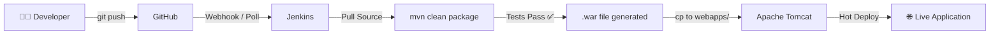

<div align="center">

# 🚀 AutoDeploy — CI/CD Pipeline with Jenkins & Tomcat

[](https://www.java.com)
[](https://spring.io/projects/spring-boot)
[](https://maven.apache.org/)
[](https://www.jenkins.io/)
[](https://tomcat.apache.org/)
[](https://github.com)

<br/>

> **A fully automated Continuous Integration & Continuous Deployment (CI/CD) pipeline** that automatically builds, tests, and deploys a Java Spring Boot web application whenever code is pushed to GitHub — using **Jenkins** as the automation server and **Apache Tomcat** as the deployment target.

<br/>


</div>

---

## 📖 Table of Contents

- [🧠 Project Overview](#-project-overview)
- [🏗️ Architecture](#️-architecture)
- [📁 Project Structure](#-project-structure)
- [⚙️ Tech Stack](#️-tech-stack)
- [🔄 CI/CD Pipeline Flow](#-cicd-pipeline-flow)
- [🛠️ Setup & Configuration](#️-setup--configuration)
- [🧪 Running Tests](#-running-tests)
- [📡 API Reference](#-api-reference)
- [🤝 Contributors](#-contributors)

---

## 🧠 Project Overview

This project demonstrates a **real-world DevOps workflow** — the same patterns used in professional software teams — where every code commit triggers an automated pipeline:

1. Developer pushes code to **GitHub**
2. **Jenkins** automatically detects the push via webhook/polling
3. Jenkins **compiles, tests, and packages** the application using Maven
4. The resulting `.war` file is **automatically deployed** to Apache Tomcat
5. The live web app reflects the latest changes — **zero manual steps**

The application itself is a **Spring Boot REST API + web frontend** (Java Calculator + Todo App) that runs on Tomcat.

---

## 🏗️ Architecture

```
┌─────────────────────────────────────────────────────────────┐
│                      DEVELOPER MACHINE                       │
│                                                             │
│   📝 Code Changes  →  git push  →  GitHub Repository       │
└──────────────────────────┬──────────────────────────────────┘
                           │  Webhook / Polling
                           ▼
┌─────────────────────────────────────────────────────────────┐
│                     JENKINS SERVER                           │
│                                                             │
│   1️⃣ Detects change (SCM polling or webhook)               │
│   2️⃣ Pulls latest code from GitHub                         │
│   3️⃣ Runs: mvn clean package (compile + test)              │
│   4️⃣ Copies .war → Tomcat webapps/ folder                  │
└──────────────────────────┬──────────────────────────────────┘
                           │  Deploy
                           ▼
┌─────────────────────────────────────────────────────────────┐
│                   APACHE TOMCAT SERVER                       │
│                                                             │
│   🌐 Hosts the web application                              │
│   🔁 Hot-reloads on new .war file                           │
│   ✅ Users see updated app immediately                       │
└─────────────────────────────────────────────────────────────┘
```

---

## 📁 Project Structure

```
Auto_Deploy_Code/
│
├── 📄 README.md                          ← You are here
│
└── 📦 java-calculator/                   ← Spring Boot Application
    ├── pom.xml                           ← Maven build config
    ├── .gitignore
    │
    └── src/
        ├── main/
        │   ├── java/com/example/calculator/
        │   │   ├── CalculatorApplication.java    ← App entry point
        │   │   └── CalculatorController.java     ← REST API controller
        │   │
        │   └── resources/
        │       └── static/
        │           ├── index.html               ← Frontend web UI
        │           └── style.css                ← Glassmorphism CSS
        │
        └── test/
            └── java/com/example/calculator/
                └── CalculatorControllerTest.java ← JUnit tests
```

---

## ⚙️ Tech Stack

| Layer | Technology | Purpose |
|-------|-----------|---------|
| **Language** | Java 17 | Core application language |
| **Framework** | Spring Boot 3.2.4 | REST API + web serving |
| **Build Tool** | Apache Maven | Compile, test, package |
| **Packaging** | WAR (Web Archive) | Deployable to Tomcat |
| **CI Server** | Jenkins | Automation & orchestration |
| **App Server** | Apache Tomcat | Production deployment target |
| **SCM** | GitHub | Source code management & trigger |
| **Frontend** | HTML + CSS (Glassmorphism) | Browser UI |
| **Testing** | JUnit 5 + MockMvc | Automated unit/integration tests |

---

## 🔄 CI/CD Pipeline Flow



### Step-by-Step Pipeline Breakdown

#### 1️⃣ Code Push → GitHub
```bash
git add .
git commit -m "feat: add new feature"
git push origin main
```

#### 2️⃣ Jenkins Detects Change
Jenkins polls GitHub every N minutes (or receives a webhook) and pulls the latest commit automatically.

#### 3️⃣ Jenkins Builds & Tests
```bash
cd java-calculator
mvn clean package
```
This compiles the Java code, runs all JUnit tests, and packages everything into a `.war` file inside `target/`.

#### 4️⃣ Deploy to Tomcat
```bash
cp target/calculator-0.0.1-SNAPSHOT.war /path/to/tomcat/webapps/calculator.war
```
Tomcat automatically detects the new `.war` and hot-redeploys the application.

#### 5️⃣ Live Update
The web application at `http://localhost:8080/calculator` now reflects all your changes — automatically, every single time.

---

## 🛠️ Setup & Configuration

### Prerequisites

| Tool | Version | Download |
|------|---------|----------|
| Java JDK | 17+ | [adoptium.net](https://adoptium.net/) |
| Apache Maven | 3.8+ | [maven.apache.org](https://maven.apache.org/) |
| Jenkins | Latest LTS | [jenkins.io](https://www.jenkins.io/) |
| Apache Tomcat | 9 or 10 | [tomcat.apache.org](https://tomcat.apache.org/) |

### Jenkins Job Configuration

#### Step 1 — Source Code Management
In your Jenkins job, go to **Source Code Management** → **Git** and enter:
```
Repository URL: https://github.com/Ahtesham-Shah999/Auto_Deploy_Code.git
Branch: */main
```

#### Step 2 — Build Triggers
Enable **Poll SCM** or configure a **GitHub Webhook**:
```
# Poll every 5 minutes:
H/5 * * * *
```

#### Step 3 — Build Step (Execute Shell / Windows Batch)
```bash
cd java-calculator
mvn clean package -DskipTests=false
```

#### Step 4 — Post-Build: Deploy to Tomcat
```bash
cp java-calculator/target/calculator-*.war /opt/tomcat/webapps/calculator.war
```

> **Windows users:** Use `copy` instead of `cp`:
> ```batch
> copy java-calculator\target\calculator-0.0.1-SNAPSHOT.war C:\tomcat\webapps\calculator.war
> ```

### Running Locally (without Jenkins)
```bash
cd java-calculator
mvn spring-boot:run
```
Then open: `http://localhost:8080`

---

## 🧪 Running Tests

```bash
cd java-calculator
mvn test
```

### Test Coverage

| Test | Description | Expected |
|------|-------------|---------|
| `testAddition` | Tests `5 + 3` via REST API | `{"result": 8.0}` |
| `testDivisionByZero` | Tests `5 ÷ 0` guard | `{"error": "Cannot divide by zero"}` |

---

## 📡 API Reference

### `GET /api/calculate`

Performs a mathematical calculation.

**Query Parameters:**

| Parameter | Type | Required | Description |
|-----------|------|----------|-------------|
| `num1` | `double` | ✅ | First number |
| `num2` | `double` | ✅ | Second number |
| `operation` | `string` | ✅ | `add`, `subtract`, `multiply`, `divide` |

**Example Requests:**
```bash
# Addition
curl "http://localhost:8080/api/calculate?num1=10&num2=5&operation=add"
# → {"result": 15.0}

# Division
curl "http://localhost:8080/api/calculate?num1=20&num2=4&operation=divide"
# → {"result": 5.0}

# Division by zero
curl "http://localhost:8080/api/calculate?num1=10&num2=0&operation=divide"
# → {"error": "Cannot divide by zero"}
```

---

## 🤝 Contributors

| Contributor | GitHub |
|-------------|--------|
| Ahtesham Shah | [@Ahtesham-Shah999](https://github.com/Ahtesham-Shah999) |
| Ibrahim Liaqat | [@ibrahim-liaqat](https://github.com/ibrahim-liaqat) |

> 💡 *We built this project together as a hands-on DevOps learning exercise to understand CI/CD pipelines from scratch.*

---

<div align="center">

**Built with ❤️ using ⚙️ Git · 🏗️ Jenkins · 🐱 Tomcat · ☕ Spring Boot**

⭐ *If this helped you, give it a star!*

</div>
